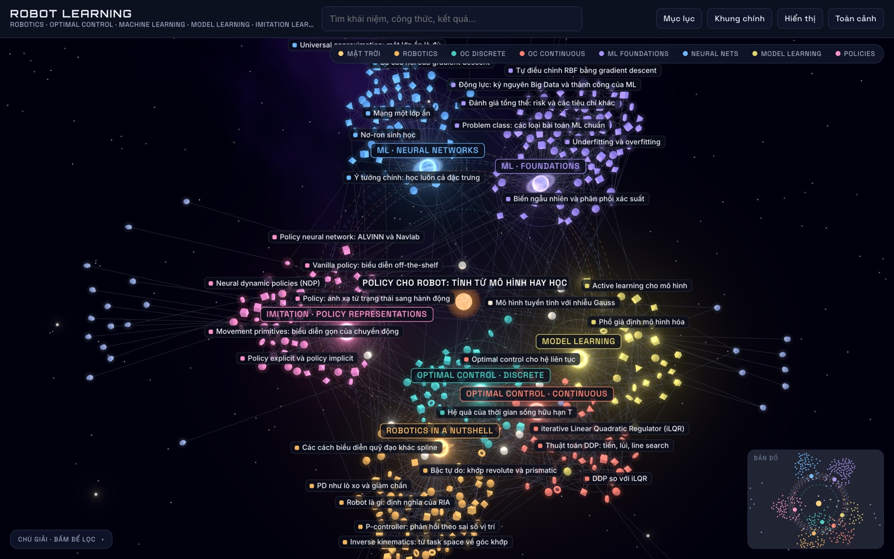
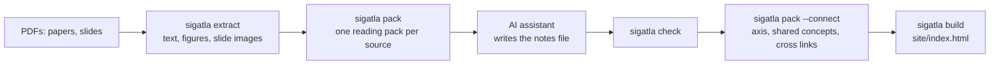

# Sigatla

[](https://github.com/sigango/Sigatla/actions/workflows/ci.yml)

Sigatla turns research papers and lecture slides into an **atlas**: an interactive 3D map of study notes in which
every note is linked to the others and every link says why the two notes are related.


*An atlas of a seven-lecture Robot Learning course (robotics, optimal control, machine learning, model learning,
and imitation learning): 460 notes and 1,444 links, written in Vietnamese. Each lecture is a planet, its notes
orbit it, and the central question of the course, "policies for robots: computed from a model or learned from
data", is the sun.*

## Contents

- [Why Sigatla](#why-sigatla)
- [What the atlas shows](#what-the-atlas-shows)
- [How it works](#how-it-works)
- [Install](#install)
- [Quick start](#quick-start)
- [Reading with your own AI assistant](#reading-with-your-own-ai-assistant)
- [Reading through the Claude API](#reading-through-the-claude-api)
- [Keeping the token cost low](#keeping-the-token-cost-low)
- [The notes](#the-notes)
- [Try the demo](#try-the-demo)
- [Commands](#commands)
- [Your files and copyright](#your-files-and-copyright)
- [Limitations](#limitations)
- [Repository layout](#repository-layout)
- [Contributing](#contributing)
- [License](#license)

## Why Sigatla

A course or a reading list is a set of PDFs that refer to each other only implicitly. A formula introduced in
lecture 2 is reused in lecture 6, a method from one paper is the baseline of another, and a limitation stated on
one slide motivates the next chapter. Linear notes lose these connections, and an AI chat that summarizes one PDF
at a time does not keep them either.

Sigatla splits the work between a tool and an AI assistant:

- **The `sigatla` tool does the mechanical work.** It extracts page text, figures, tables, and slide images from
  the PDFs, writes a self-contained reading task for each source, validates the notes, and builds the website.
- **An AI assistant reads and writes.** It reads each source and fills in a fixed notes form: concepts, methods,
  formulas, design choices, results, limitations, examples, and related work, each linked to the notes it builds
  on. Any assistant that can run shell commands and read files can do this (Claude Code, Codex, Cursor, Copilot,
  Gemini, and others), or the tool can call the Claude API directly.

The result is a static website: open `site/index.html` in a browser or put the folder on any static host, and
extend it as the course goes on. No server is needed, but the page loads its 3D and math libraries from public
CDNs, so it needs an internet connection.
It is meant for learning a course from its slides, preparing an exam, a thesis defense, or a research interview,
and seeing how a set of papers fits together.

## What the atlas shows

### Notes with structure

Each note has the sections its type needs: a formula comes with every symbol explained and the reason for its
form, a design choice with the alternatives it rules out, a result with the numbers exactly as reported. Notes
cite the pages or slides they come from, and anything the assistant adds beyond the source (an intuition, a
comparison, an outside fact) starts with an "Interpretation:" marker. Formulas are typeset with MathJax.


*Opening a note flies the camera to it, highlights its links, and shows the note in the side panel. This note is
a concept shared by several lectures, and the panel lists how each lecture uses it.*

### Relations you can read

Every link has a relation (`uses`, `extends`, `motivates`, `contrasts`, `limits`, `supports`, `tests`, and a few
more) and a one- or two-sentence note saying how or why it holds. Links are colored by family (evidence, tension,
method, context, and structure). Clicking a link opens its note, and the legend filters the map by source, note
type, and link family.

### Paths between notes

Pick two notes and Sigatla finds the shortest chain of relations between them, preferring content relations over
"part of" links and avoiding detours through the planets. Each step shows the link note, so the chain reads as an
argument.


*A four-step path from the LQR system (optimal control) to Deep Lagrangian Networks (model learning). The panel
explains each step and offers a question box for the whole chain.*

### A flat view for reading

The 3D view is good for seeing the shape of a course; the flat view presses every note into the plane for
reading. You move around by dragging, scrolling at the cursor, using the arrow keys, or clicking the minimap.
A bar at the top jumps to the sun or to any source, and dragging a planet away from the sun widens its orbit
(the browser remembers it).



### Also on the page

- **Search** over titles, summaries, and note bodies, and a **table of contents** that lists the notes of each
  source by type.
- **Figures, tables, and slides** next to the notes that use them, with a lightbox for full size. Every slide of
  a deck is kept as an image, and build-up steps (a slide exported several times as it fills in) are merged into
  one slide.
- **Questions to Claude** from any note, link, or path, with that context attached. See
  [Questions from the page](#questions-from-the-page).
- **English or Vietnamese interface,** following the language of the notes.

## How it works



1. **Extract.** `sigatla add` copies a PDF into the project and extracts it with PyMuPDF: page text, figures and
   tables located from their captions, and, for slides, every page as an image with build-up steps merged.
2. **Read.** `sigatla pack <id>` writes a reading pack, one Markdown file with the whole task: the reading rules,
   the outline of the source, the slide text, which slides to look at, the figure ids the notes may use, the ids
   that already exist in the atlas, and the output schema. The assistant reads the pack, writes
   `notes/<id>.json`, and stops. Long decks are split by section into parts, and each part is a job of its own.
3. **Check.** `sigatla check` reports errors (invalid JSON, missing fields), warnings (figure ids or link targets
   that do not exist, which the build would drop), and hints (a formula note without display math, a result
   without a number, a link that repeats an existing pair in reverse). The assistant fixes them with small edits.
4. **Connect.** Once two or more sources are read, `sigatla pack --connect` asks for the central question of the
   atlas (the sun), a handful of concepts shared across sources, and links between notes of different sources.
5. **Build.** `sigatla build` writes `site/`: one HTML page with the notes injected, plus the figure and slide
   images. Nothing needs a server.

`sigatla next` works out which of these steps is due from the files in the project and prints the commands, so
neither you nor the assistant has to keep track.

## Install

Python 3.10 or newer.

```bash
git clone https://github.com/sigango/Sigatla.git
cd Sigatla
python3 -m venv .venv && . .venv/bin/activate      # Windows: .venv\Scripts\activate
pip install -e .
sigatla --version
```

The dependencies are PyMuPDF and the Anthropic Python SDK (used only by the API path).

## Quick start

```bash
sigatla init my-course --title "Computer Vision II" --lang en
cd my-course
sigatla add ~/Downloads/lecture-03.pdf --kind slides --label "Lecture 3 · Optical flow"
sigatla add ~/Downloads/raft.pdf --kind paper --label "RAFT · ECCV 2020"
sigatla next
```

`--lang` sets the language of the notes (`en`, `vi`, `de`, `fr`, and others); technical terms stay in their
original form. Slides from PowerPoint, Keynote, or Google Slides must be exported to PDF first. Use
`--kind slides` for lecture decks, `--kind paper` for papers, and `--kind notes` for other documents.

From here, the notes are written either by your own AI assistant or through the Claude API.

## Reading with your own AI assistant

No API key is needed: the reading happens in the assistant you already use. `sigatla init` writes a short
`AGENTS.md` into the project folder (and a `CLAUDE.md` that imports it), so an assistant started there knows the
workflow. For a project made with an older version, run `sigatla guide` once.

Start the assistant in the project folder and ask, for example:

```text
Read the new slides into this atlas. Run `sigatla next` and follow it.
```

```text
Read every source into this atlas: give each reading job from `sigatla next` to its own subagent, in parallel.
When they are done, connect the sources and build the site.
```

```text
Read lecture-03 into this atlas, then add a note on the Lucas-Kanade method to it.
```

`sigatla next` prints what is left as commands, for example:

```text
Reading jobs left: 2. Give each one to a fresh assistant or subagent (they can run in parallel). Each runs its
command, reads the pack the command writes, and follows it:
  sigatla -C my-course pack lecture-03
  sigatla -C my-course pack raft
When every job is done, run `sigatla next` again.
```

After the reading jobs, it asks for the connecting step and then for the build, and finally prints the path to
`site/index.html`. `sigatla serve` opens the site at http://127.0.0.1:8000.

The full guide for assistants is [AGENTS.md](AGENTS.md). For Claude Code, the same workflow is also packaged as
a skill in [skills/sigatla-read](skills/sigatla-read/SKILL.md). The workflow was developed and tested with Claude
Code; other assistants follow the same files.

## Reading through the Claude API

With `ANTHROPIC_API_KEY` set (or an `ant auth login` profile), the tool calls the Claude API itself:

```bash
sigatla read        # reads every source without notes; shows a token estimate and asks first
sigatla connect     # writes the central question, shared concepts, and cross links
sigatla build       # writes site/index.html
sigatla serve       # opens the site, with questions answered through your key
```

`sigatla update` runs extract, read, connect, and build in one go. Both `read` and `connect` count the tokens of
each request and show an estimate before sending; nothing is sent until you confirm (or pass `--yes`). The
default model is `claude-opus-5-5`; change `model` in `atlas.json`. A 10-page paper is roughly 20–40k input
tokens plus the notes Claude writes.

## Keeping the token cost low

An assistant sends its whole conversation again at every step, so the cost of a reading job is roughly what is
in its context times the number of steps. Sigatla is designed to keep both small:

- **One job per fresh assistant.** Each reading job (one source, or one part of a long deck) is meant for a fresh
  assistant or subagent, and jobs can run in parallel. Reading two parts in one conversation would carry the
  first part's slides and notes along into every step of the second.
- **The pack is the whole task.** The assistant does not need to read the tool's source code, the full guide, or
  other notes files; the pack says what to read, what to write, and how to check it.
- **Contact sheets.** Slides that need to be seen (formulas, diagrams, plots) are drawn four to an image, each
  labeled with its PDF slide number. Four slides on one sheet cost about 2,500 image tokens, against about 6,500
  for four full-size slide images. Slides whose text is complete in the pack are marked as needing no image.
- **Narrow lookups.** `sigatla ids --grep "<regex>"`, `sigatla show <id> ...` (or `--brief` for one line per
  note), and `sigatla check --source <id>` print only what a step needs.
- **Write once, then edit.** The assistant writes a notes file once and fixes what `sigatla check` reports with
  small edits.


*A contact sheet from the demo deck. The pack lists which sheet holds which slides, and which slides need no
image at all.*

The connecting step works the same way: its pack lists every note by id, type, and title, and the assistant
prints the notes it needs with `sigatla show --brief`. For the Robot Learning atlas above, this index is 61 KB.

Reading is most of the cost. If you want to spend less, a smaller model can do the reading jobs and the strongest
model the connecting step; check a few notes from the smaller model first.

## The notes

Notes are plain JSON files in `notes/`, one per source (`notes/<id>.json`, plus `notes/<id>.part-<k>.json` for
the later parts of a long deck), and `notes/_shared.json` for the connections. You can edit them by hand,
re-run `sigatla build`, and the map updates.

| Note type | What it holds |
| --- | --- |
| `concept` | a definition and how the source uses it |
| `method` | the procedure, its inputs and outputs, and why it works |
| `formula` | the formula, every symbol, its meaning, and why it has this form |
| `design` | a design or study choice, the alternatives, and the reason |
| `result` | a reported result with its numbers and setting |
| `limitation` | what the source says does not work, or where it stops |
| `data` | a dataset or benchmark |
| `example` | a worked example from the source |
| `related` | a cited work, a course, or a book, with one id per work across the atlas |

Four rules matter most, and every reading pack repeats them:

- **Faithful.** Numbers, datasets, and claims come only from the source, exactly as reported.
- **Marked.** The assistant's own explanations start with the interpretation marker of the notes' language.
- **Real ids.** Figure ids, slide ids, and link targets must exist; page numbers are PDF page numbers.
- **Explained links.** Each link carries a short note saying how or why the relation holds, and a pair of notes
  gets one link.

The full form, with the sections each type needs, is in [docs/NOTES_FORM.md](docs/NOTES_FORM.md), with a JSON
Schema in [schema/](schema/). `sigatla form <type>` prints a blank note to fill in. The project folder and the
data injected into the page are described in [docs/DATA_FORMAT.md](docs/DATA_FORMAT.md).

A project folder looks like this:

```text
my-course/
  atlas.json        title, language, model, and the list of sources
  sources/          the PDFs
  notes/            the notes (JSON), written by the assistant or by hand
  build/            extracted text, figures, slide images, reading packs, contact sheets
  site/             the website (index.html plus images)
  AGENTS.md         short guide for AI assistants, written by `sigatla guide`
  CLAUDE.md         imports AGENTS.md for Claude Code
```

## Try the demo

`examples/demo` holds a small project: two short lecture decks written for this repository (saliency maps and
evaluating explanations) and their notes.

```bash
cd examples/demo
sigatla extract
sigatla build
open site/index.html          # Linux: xdg-open, Windows: start
```

The two decks have not been connected yet, so `sigatla next` asks for the connecting step: a good first task for
your assistant.

## Commands

| Command | What it does |
| --- | --- |
| `sigatla init [dir] --title --lang` | Create a project (`atlas.json`, `sources/`, `notes/`, `AGENTS.md`). |
| `sigatla add file.pdf --kind paper\|slides\|notes [--label] [--short]` | Copy a PDF into the project and extract it. |
| `sigatla next` | Print the next steps as commands: reading jobs, connecting, building. |
| `sigatla pack [ids] [--part k] [--connect]` | Write a reading pack for an AI assistant. |
| `sigatla extract [ids] [--force]` | Extract page text, figures, tables, and slide images to `build/<id>/`. |
| `sigatla ids [--source id] [--related] [--grep regex]` | List note ids with their titles. |
| `sigatla show ids... [--brief]` | Print notes by id, several in one call. |
| `sigatla check [--source id]` | Validate all notes, or one source's (`shared` for the connections). |
| `sigatla form [type\|source] [--lang]` | Print a blank note or notes file to fill in. |
| `sigatla build [--out dir]` | Write the website. |
| `sigatla serve [--port]` | Serve the website locally, with questions answered through your API key. |
| `sigatla status` | List sources, figures, and notes. |
| `sigatla guide` | Write `AGENTS.md` and `CLAUDE.md` for AI assistants into the project folder. |
| `sigatla read [ids] [--effort] [--yes] [--dry-run]` | Read sources through the Claude API. |
| `sigatla connect [--yes]` | Connect the sources through the Claude API. |
| `sigatla update` | Extract, read, connect, and build in one go (Claude API). |

Every command works on the project folder that contains `atlas.json`: run it inside the folder, or pass
`-C <folder>` before the subcommand.

### Questions from the page

The page picks a mode on its own:

| Where the page runs | "Ask" | Saved answers |
| --- | --- | --- |
| `sigatla serve` with API credentials | Claude answers in the page (your key, on your machine) | `notes/_qa.json`, included in the next build |
| `sigatla serve` without credentials, or a static host | "Copy prompt for Claude", to paste into claude.ai | in the browser, plus any included in the build |
| A claude.ai artifact | Claude answers in the page | the artifact's shared storage |

## Your files and copyright

Your PDFs, the extracted images, and the notes stay in your project folder; only the API path sends a PDF to the
Claude API for reading. The built site contains cropped figures and slide images from your sources, so do not
publish a site built from material you are not allowed to share (unpublished papers, paywalled papers, or course
slides) without permission. The screenshots above come from an atlas built for personal study; the course slides
themselves are not part of this repository.

## Limitations

- Figures and tables are found from their captions ("Figure 3:", "Table 2.", "TABLE II"). Unusual layouts can
  produce a loose or missed crop; the assistant still sees the full page.
- Scanned PDFs have no text layer. The assistant reads the page images, but search and figure detection are
  weaker.
- The Claude API reads PDFs up to 600 pages and about 32 MB per request; larger files are re-rendered or must be
  split.
- Slides must be exported to PDF.

## Repository layout

| Path | What |
| --- | --- |
| `sigatla/cli.py` | the command line |
| `sigatla/extract.py` | PDF extraction with PyMuPDF: text, caption-based figure and table crops, slide images |
| `sigatla/pack.py`, `sigatla/sheets.py` | reading packs, and which slides go on contact sheets |
| `sigatla/prompts.py`, `sigatla/form.py` | the reading rules and the notes form, shared by both reading paths |
| `sigatla/build.py` | validation (`check`) and the website build |
| `sigatla/guide.py` | `sigatla next` and the project's `AGENTS.md` |
| `sigatla/claude.py`, `sigatla/serve.py` | the Claude API path and the local server |
| `sigatla/web/index.html` | the page template (3d-force-graph and three.js for the scene, MathJax for formulas) |
| `AGENTS.md`, `skills/sigatla-read/` | the guide for AI assistants, and the same workflow as a Claude Code skill |
| `docs/`, `schema/` | the notes form, the data format, and the JSON Schema |
| `examples/demo/` | a small project with two lecture decks and their notes |
| `tests/` | `pytest` tests, run by continuous integration on Linux, macOS, and Windows |

## Contributing

Contributions are welcome. [CONTRIBUTING.md](CONTRIBUTING.md) explains how to set up the code, which checks a
pull request needs, and how changes are reviewed. Every pull request is tested on Linux, macOS, and Windows
before it is merged.

## License

MIT. The page loads 3d-force-graph (MIT), three.js (MIT), and MathJax (Apache-2.0) from public CDNs, and fonts
from Google Fonts (SIL Open Font License).
